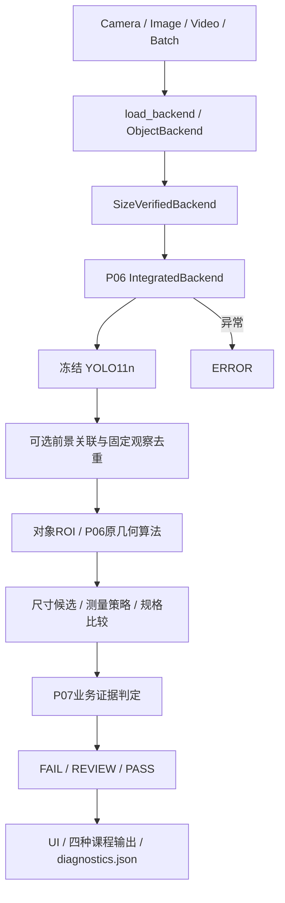
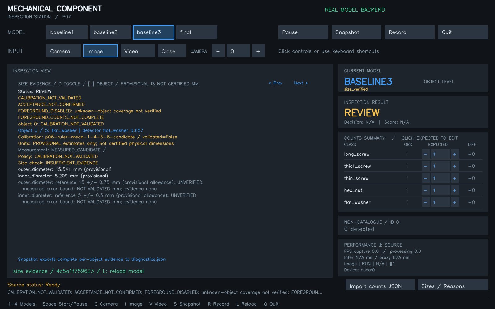

# Baseline3 P07尺寸证据接入与判定（2026-11-25）

## 当前状态

已将P06最新交付的真实检测、可选前景关联、几何候选测量、规格区间比较及测量策略接入P07。默认尺寸模式能够运行和诊断，但**尚未完成物理标定、规格确认、测量误差验证或完整Stage2验收**。未重新训练、未改几何算法、规格、公差、冻结YOLO参数或P03。正式Test: NOT_RUN。

当前真实标定仍为validated=false，策略注册表仍为空，foreground_enabled仍为false。没有将这些字段改成已验证，也没有生成伪造的教师/卡尺/误差界记录。

## 两种明确模式

| 模式 | 启动配置 | 用途 |
|---|---|---|
| size_verified | config/p07.json，默认 | 完整证据链与保守业务判定；数量相符不直接放行 |
| yolo_frozen | config/p07_yolo_frozen.json | 原冻结YOLO计数基线对照；不代表完成尺寸核验 |

`model_config.baseline3_mode`管理模式，`baseline3_pipeline_config`指定候选管线，`baseline3_acceptance_approval`缺省null。无效模式或管线加载失败明确ERROR，不退回yolo_frozen。图像、视频、Camera及predict.py使用相同load_backend和adapter。

```powershell
python app.py --model baseline3
python app.py --model baseline3 --config config/p07_yolo_frozen.json
python predict.py --model baseline3 --input_dir "允许的Validation目录" --counts_file results/data_manifests/work_orders/validation.json --output_dir outputs/size_new_run
python predict.py --model baseline3 --config config/p07_yolo_frozen.json --input_dir "允许的Validation目录" --counts_file results/data_manifests/work_orders/validation.json --output_dir outputs/frozen_new_run
```

不要把yolo_frozen对照的PASS解释为已经通过物理尺寸核验；其原始能力和局限保留用于复现。Baseline1/2固定工单限制保持不变；Final没有被接到Baseline3。

## 修复前后调用链

修复前：默认P07 → Baseline3旧adapter → YOLO → 数量比较。尺寸配置走旧模块导入/旧路径而失败。

修复后默认：



迁移后的唯一检测模块为src/models/baseline3/inference.py，类别/标注工具为src/data/p06_labelme.py。旧src.p06_inference和src.p06_data引用直接修正，没有建立同名兼容副本。候选detector_config_path指向config/baseline3.json。背景参考使用支持中文路径的解码入口。

P06继续提供候选观察，P07 adapter拥有最终业务判定。ObjectBackend对声明business_decision_owner=baseline3_adapter的后端不再以纯数量规则覆盖尺寸FAIL/REVIEW；重判也委托adapter。其他对象提供者原约定和Baseline1/2逻辑保留。

## PASS、FAIL、REVIEW、ERROR

尺寸模式按以下优先顺序处理：

1. 加载、输入、文件变更、缓存破坏或程序异常：ERROR，由公共入口/工作线程导出错误，不伪造业务标签。
2. 原始或保留观察中有ID0：FAIL，明确警告。可信规格证据确认错尺寸/错类型、或确认预测类别与规格冲突：FAIL。
3. 实际数量与工单不同，且没有检测上限或显式前景计数歧义：FAIL。仍保留标定/测量问题作为诊断原因。
4. 达到检测上限、前景背景不可用或候选未解决、标定缺失/未验证/分辨率或机位ID不匹配、规格接受未确认、对象测量失败或没有匹配可信策略：REVIEW，标签及整图分数为空。
5. 只有数量相符、无ID0/已确认拒识、标定有效、接受范围确认、前景计数完整且每个目标具有可信兼容规格证据，才PASS。

同时有已知失败与其他不确定条件时FAIL优先，所有review_reasons仍保留。前景观察本身有歧义时，不能仅用一个不完整数量向量断言缺件；这类数量差保留为REVIEW原因。

这是基于模型观察和P06证据的业务判定，不是读取GT确认。YOLO漏检、误分类、轮廓错误仍会影响观察，软件规则无法代替算法真实性能。

真实P06交付尚未满足全部信任门；因此当前正常数量样例REVIEW有明确原因，不是硬编码全部REVIEW。缺件、多件和已检出ID0在实际诊断中返回FAIL；完整PASS分支仅在明确标识的合成业务夹具上验证，没有宣称真实物理PASS已验收。

### 观察保持不变

工单仅参与业务重判。IntegratedBackend缓存摘要检查后复制既有观察，YOLO、前景和测量均不重跑。原始框、YOLO类别、分数、尺寸及实际计数不因工单变化而改变。可信且已确认的OUTSIDE_FAMILY尺寸证据将对象的最终语义归为class0并重计最终数量；原始YOLO类别/计数完整保留在p06_evidence.raw_observations，诊断对象另标detector_class_id和class_assignment=size_rule_non_catalogue。此归类完全不使用expected_counts，因此改工单不会改变原始或最终观察。

规则拒识后的对象保留原检测目标分数，元数据明确它不是新生成的YOLO class0概率；UI将其标作confirmed size rule，不能假装是YOLO直接检出。当前真实证据未达到这个门，尚无真实尺寸拒识验收成绩。已确认的类内规格与检测类别冲突保守FAIL并单独标记，不自动把它冒充目录外类型。

## 界面和导出

Baseline3显示当前模式。点击 **Sizes / Reasons** 或按D打开/关闭证据面板，Prev/Next或[、]逐对象查看：

- YOLO类别与目标分数（不是测量置信度）；
- 标定ID、validated状态及具体不匹配原因；
- 几何测量状态、实际候选值；
- 规格参考、允许量、WITHIN/OUTSIDE/UNVERIFIED等区间结果；
- 实际验证误差界和证据ID；缺失时明确NOT VALIDATED；
- policy匹配、拒识、失败及REVIEW原因。

未完成标定/接受确认的毫米估计显式显示 **PROVISIONAL**，不是认证物理尺寸。详情页为原图上的可切换面板，不改变预测。



四种课程输出字段不变。objects.csv只写规定字段，不把嵌套尺寸字典直接塞入CSV。快照和Baseline3批处理另外生成diagnostics.json：

```text
schema_version
model: 模式、真实权重、标定、规格、策略记录、消费文件SHA256
images[]:
  image_id / expected_counts
  result:
    status / objects / counts / inspection
    p06_evidence: raw_observations、foreground、unresolved_candidates等
```

内部缓存字段以_开头，不写入公开诊断副本；公开证据已包含原始观察。模型/配置/策略证据/相关算法文件变化要求重新加载，不静默继续使用过期证据。

## 前景调试入口

不在本次配置中启用不存在的背景。复制候选pipeline到outputs下新的站点配置，使用真实空背景和哈希、正确ROI及机位标识后，再显式设置foreground_enabled=true。背景缺失/不可用或关联不完整会阻止尺寸模式PASS。未匹配候选保持class_id=null和REVIEW原因，不自动伪造ID0或置信度。

```powershell
python -m scripts.check_baseline3_size
# 已有真实站点资料后，可调试一个独立配置；不会自动标定或修改阈值：
python -m scripts.check_baseline3_size --pipeline-config outputs/你的新站点/pipeline.json
```

默认诊断使用批准的Validation及派生的离线视频；不是现场新帧测量。自定义站点配置可能改变诊断结论，须独立记录，不覆盖旧结果。

## 亲自操作与物理验收步骤

1. **固定工位**：P01确认白色哑光台面、光源、相机/镜头/zoom/焦距、分辨率、工作距离和姿态。Camo本机DSHOW0仅为既有记录，重新核对设备。固定机位并拍照，生成新的capture_geometry_id。软件只校验标识和分辨率，不能自动发现相机高度或倾斜已变。
2. **真实标定**：同分辨率同工位拍可追溯尺度参考，记录x/y点位、真实长度、拟合残差与重复性；检查中心和边缘。不可按3024到1280的比例臆测Camo尺度。新calibration使用独立文件，未完成验证前仍false；换机位、距离或倾斜必须重新标定。
3. **实物测量**：给每个正常/错误规格实物唯一specimen_id，用卡尺记录头下长度、螺纹大径、螺母对边、垫圈内外径。保留测量工具、测量定义、重复读数和可判断标记；将实物对应到图片与实例。名义商品规格差不能当作算法真实误差。
4. **P06验证测量范围**：在批准Train/Validation或独立开发诊断集上记录成功/失败、逐尺寸误差、错误规格误放、正常件误拒和覆盖率。P06修复必要算法后为具体版本/参数/工位/分辨率/类别/诊断量范围建立真实max_error_mm与family_confirmed依据。不得把验证标志随手设true。
5. **登记真实策略**：按docs/p06/measurement_policy.md创建有真实证据的独立记录和SHA256引用；registry中不得伪造records。记录必须匹配geometry SHA、参数、标定ID、x/y尺度、图像大小及诊断范围。不满足的尺寸继续UNVERIFIED。
6. **取得确认**：教师确认目录、尺寸允许范围及支持成像条件；保留真实确认资料。P07不修改候选规格数值。另存接受记录，通过model_config.baseline3_acceptance_approval引用，缺省保持null。
7. **真实空背景与前景验证**：同机位/光线采空台面，计算字节SHA，填写background的path/file_sha256/reference_id/roi。验证未知件、接触、阴影、光照及背景变化；候选关联不确定仍REVIEW。
8. **功能与视频**：正常、缺件、多件、数量正确但加ID0、近似错规格、纯空台面、无关画面、旋转/遮挡/反光分别验收；改工单核对框、类别和数量不变。再分别采≥20个实际新帧报告Median/P95/FPS，并保留失败输入和日志。正式Test仍须独立批准后才能运行。

### 接受记录格式（定义，不是已存在的确认）

接受文件只允许status=CONFIRMED、approved_by、confirmed_at、file_hashes、evidence_path、evidence_sha256。file_hashes必须有以下五个键，值为真实文件SHA：pipeline_config_path、specs_path、calibration_path、measurement_policy_path、foreground_config_path。pipeline配置同时绑定空背景哈希和机位。确认文件与真实证据文件、注册表引用文件被检查并纳入运行快照。哈希只能绑定文件，不能自动证明签字者或物理事实，仍需人工审核。

本次没有生成任何这样的确认记录。

## 尚需P06解决的算法问题

- 默认body_profile的肩部/尖端/杆径仍有阴影、反光和头颈混淆；不能将可选edge_audit效果写成默认效果。
- size_processor扩大ROI但未向measure_object传target_box；邻件/触边风险保留，本次没有改动裁剪或核心几何算法。
- 螺母内孔、真实三维高度/透视/镜头畸变补偿未实现；并非要求必须采用特定算法，但须限制/验证支持工况。
- 前景未匹配不自动等同机械目录外件，目录外覆盖和错规格拒识仍需真实数据。
- 已有类别几何“返回候选”的比例不是MAE、准确率、正常件通过率或FAR/FRR；需要卡尺GT。

以上属于可靠完成Stage2目标或其支持条件，不将其包装为Stage3创新。

## 更新的Stage2状态

| 要求 | 官方出处 | 当前状态 | 证据边界 |
|---|---|---|---|
| 管线导入、配置路径、默认P07接入 | 可复现系统 | PASS（工程接入） | 实际CUDA、图像/离线视频/批处理；不等于物理验收 |
| 五类+ID0框、计数 | PDF第2/5页 | PASS（功能检查） | 批处理/实际样例；目标级泛化指标未补做 |
| 任意工单且观测不变 | 第2/12页 | PASS（功能检查） | 同帧两次重判不重测/重检测 |
| 已检测ID0强制FAIL | 第5页 | PASS（功能检查） | 真实ID0样例，未扩大为所有未知件检出 |
| 尺寸不确定不得静默PASS | 第2页 | PASS（软件保护） | 真实候选标定false时REVIEW；完整可信PASS仅合成逻辑夹具 |
| 可重复几何、尺度、容差和教师确认 | 第3页 | NOT VERIFIED | 实际配置仍false、records空、接受确认null |
| 错规格/错类型定位与真实拒识 | 第2–3/5页 | PARTIAL | 业务链与候选证据已接；真实拒识精度及语义输出待验证 |
| 未见机械零件覆盖 | 第5页 | PARTIAL | 前景可调试但当前关闭/无实际背景；未匹配不冒称ID0 |
| 课程四种输出与可追溯诊断 | 第12页 | PASS（接口） | 保留字段，增加diagnostics sidecar |
| 正式目标级评估、错误案例与尺寸误差 | 第5–7页 | NOT VERIFIED | 本次只做集成诊断，不访问正式Test |
| 实机三模型新帧、≥20帧延迟与视频 | 第5–7页 | NOT VERIFIED | 离线视频不是现场证据 |
| 精确未知类型/精确毫米测量作为独立交付项 | 第2页明确不要求 | NOT REQUIRED | 尺寸拒识能力仍必须满足 |

验证记录入口：results/integration/baseline3_size_20261125/。本版本可以作为可运行、可诊断的集成候选；仍不能声明完整Stage2物理功能验收通过。

## 修改文件与原因

| 文件组 | 原因 |
|---|---|
| config/p07.json、p07_yolo_frozen.json、p06_p07_pipeline_candidate.json、p06_pipeline_candidate.json | 显式模式、统一adapter入口、修复失效检测配置路径 |
| src/p06_pipeline.py、p06_foreground.py、p06_size_evidence.py | 修复迁移导入及背景中文路径读取；不改几何方法 |
| src/adapters/baseline3.py、p07_bridge.py | 接入候选证据、可信业务门、ID0/规格归类、保持缓存与判定所有权 |
| app.py、p07_dashboard.py、p07_output.py、src/inference/batch.py | 可点击尺寸详情、分对象诊断、模式标识、标准CSV与额外sidecar |
| scripts/check_baseline3*.py、check_work_orders.py | 显式冻结对照与尺寸模式实际诊断、子进程UTF-8日志 |
| P06 tools/tests及新增size integration测试 | 直接指向唯一迁移模块；修复测试夹具中文路径/编码，验证决策、缓存、模式和导出 |
| README、架构/接口/P06交接文档、results新增子档案 | 更新当前入口、保留历史范围、公开实际验收与未完成项 |

下列清单对应本次未提交工作区，不包含outputs中的本地原始运行、视频诊断和保护快照：

```text
README.md
app.py
config/p06_p07_pipeline_candidate.json
config/p06_pipeline_candidate.json
config/p07.json
config/p07_yolo_frozen.json
docs/baseline3_integration.md
docs/baseline3_size_details.png
docs/baseline3_size_integration.md
docs/model_integration.md
docs/p06/HANDOFF_P07.md
docs/p06/compliance_review.md
docs/p06/pipeline.md
docs/system_architecture.md
results/DIRECTORY_TREE.txt
results/README.md
results/integration/baseline3_size_20261125/README.md
results/integration/baseline3_size_20261125/acceptance.json
results/integration/baseline3_size_20261125/baseline12-regression.json
results/integration/baseline3_size_20261125/diagnostics.json
results/integration/baseline3_size_20261125/protection.json
results/integration/baseline3_size_20261125/source_manifest.json
results/integration/baseline3_size_20261125/unit-tests.log
results/integration/baseline3_size_20261125/work-order-regression.json
scripts/check_baseline3.py
scripts/check_baseline3_size.py
scripts/check_work_orders.py
src/adapters/baseline3.py
src/inference/batch.py
src/p06_foreground.py
src/p06_pipeline.py
src/p06_size_evidence.py
src/p07_bridge.py
src/p07_dashboard.py
src/p07_output.py
tests/test_baseline3_adapter.py
tests/test_baseline3_size_integration.py
tests/test_p06_accepted_data.py
tests/test_p06_data.py
tests/test_p06_dataset.py
tests/test_p06_dataset_v2.py
tests/test_p06_foreground.py
tests/test_p06_measure_candidate.py
tests/test_p06_measurement_policy.py
tests/test_p06_pipeline.py
tests/test_p06_preview.py
tests/test_p06_reference_v2.py
tests/test_p06_size_evidence.py
tests/test_p07_dashboard.py
tools/p06_accepted_data.py
tools/p06_build_dataset.py
tools/p06_build_dataset_v2.py
tools/p06_check_part_specs.py
tools/p06_compare_resolution.py
tools/p06_prepare.py
tools/p06_preview_annotations.py
tools/p06_reference_v2.py
tools/p06_train_baseline.py
tools/p06_verify_inference.py
```
